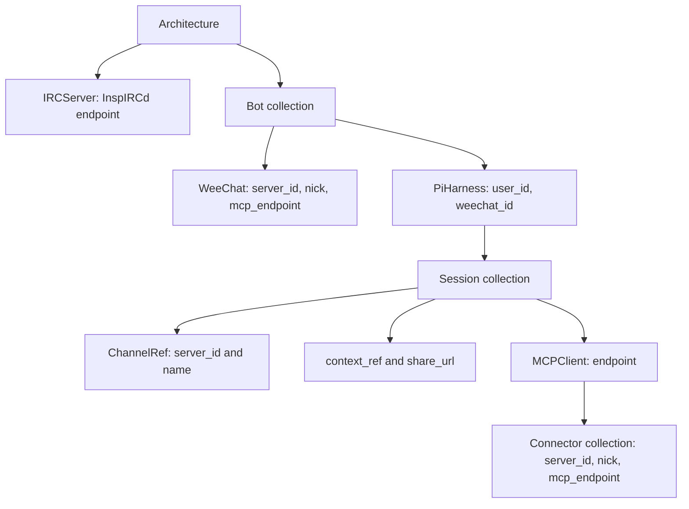

# Canonical IRC/MCP operator: design and plan

2026-10-17. This document reconciles the [original design gist](https://gist.github.com/r33drichards/4da908ee769df274a16fa76ea1e1b1ae)
with the user's revised canonical Python base types. [The original design text](history/original-design-and-plan.md)
is retained for provenance; its speculative resource APIs do not override this contract.
This is an initial data/validation scaffold, not a deployed resource manager.

## 1. Design

### 1.1 Canonical topology

The exact domain contract is [models.py](../src/cuse_operator/models.py): UserId and
SessionId are NewType aliases over strings; all nine dataclasses are frozen/slotted.
Tuple collections default to empty only where specified. Connector remains exactly
`id, server_id, nick, mcp_endpoint`; no invented provider discriminant or tool API is
added. These objects express desired relationships, not Kubernetes metadata, runtime
handles or upstream provider schemas. IRCServer represents the intended InspIRCd
service, but its endpoint is data and does not create a deployment today.

### 1.2 Ownership and resource envelope

The first resource is one namespaced aggregate `Architecture` with canonical data
under `spec`. The full graph can be validated atomically without resolving mutable
cross-resource Kubernetes references. Embedded objects are not independently managed
CRDs. This avoids two authorities for the same sessions/connectors while establishing
the requested data foundation. Splitting the aggregate later requires a reviewed
version/migration and identity policy, not a silent reinterpretation of these types.

The provisional API group is `cuse.io`, version `v1alpha1`; no ownership of that domain
is asserted. Choose an owned domain before production use. Kubernetes names/UIDs and
namespace are envelope metadata, never substitutes for domain IDs. Domain IDs are
not forced into DNS-label syntax. Arrays retain order and are atomic under default
Kubernetes list semantics; list-map merge policies require a future API decision.

`status` contains only phase (`Valid`/`Invalid`), observedGeneration, reason and generic
message. No messages, transcripts, endpoints, submitted values or exception details
are copied into it. No Ready claim is made. Kubernetes spec and Kopf diff-base
annotations are not secret stores. Context storage and share URLs must remain
non-credential-bearing references, with actual access control outside this model.

### 1.3 Validation layers and scope

1. Strict codec: rejects unknown/missing fields, scalar coercion, wrong nested types
   and non-array JSON collections. Produces tuple collections and validates semantics.
2. Domain validation: also checks objects built directly with dataclass constructors,
   which intentionally do not execute validators or I/O.
3. Structural CRD: generated from type hints, explicit properties/items/required and
   defaults; checked for schema drift. Kubernetes prunes unknown schema fields in its
   normal path. The Python codec rejects them before submission. Strict server field
   validation may reject extras, but this scaffold does not promise universal rejection.
4. Kopf handler: validates persisted desired state and records sanitized status.
   Semantic errors can therefore be persisted today. Admission hardening is issue #4.

IDs are nonempty, have no surrounding whitespace or controls. Bot, WeeChat and harness
IDs are unique within an Architecture; session IDs within a harness; Connector IDs
within one MCP client. User IDs may repeat. Each Session owns its MCP client; client
IDs are not forced globally unique. References must agree with containing objects:
WeeChat and connectors point to the architecture IRC server, harness points to its
Bot's WeeChat, sessions point to their harness and the same server via ChannelRef.

Channels require a standard IRC prefix and reject protocol separators/controls.
Nicknames reject whitespace/controls; server-specific nickname limits, CASEMAPPING,
channel length and collisions are deferred until server capabilities are known.
Endpoints and share_url are absolute hierarchical URLs with a host. Custom schemes
and internal hostnames are allowed; reachability and TLS policy are provider concerns.
context_ref may be an opaque storage key/path or URI. Known credential parameters,
userinfo, encoded userinfo, malformed ports and URL whitespace/control/backslashes
are rejected. Opaque secret detection is inherently incomplete; callers must never
supply signed/bearer URLs or secrets hidden in paths, fragments or storage keys.

### 1.4 Reconciliation boundary

The pure `reconcile(spec, generation)` function is deterministic, validation-only and
has no external side effects. Kopf create/update/resume adapters patch validation
status. No delete handler/finalizer is registered and no infrastructure is provisioned.
Configuration errors become Invalid, not retry storms; future provider errors must be
classified separately (transient, terminal, uncertain outcome).

Kopf progress and diff-base persistence use annotations. Event posting and namespace/
CRD scanning are disabled. The sample Role permits only get/list/watch/patch of this
CR and patch of status in one namespace. Run one standalone replica with explicit
namespace selection; this is not HA/leader election. Provider credentials, Secret reads,
workload mutations and broad cluster permissions are absent. Schema installation is
an administrative step outside runtime RBAC. Initial discovery relies on standard authenticated API discovery access. No live-cluster integration was run for
this scaffold; offline JSON Schema tests do not prove API-server or RBAC compatibility.

### 1.5 Deferred operational architecture

The historical design's durable routing, recovery and tenant-isolation concerns remain
useful requirements, but must be mapped to these canonical objects before implementation.
Kubernetes reconciles infrastructure intent; it is not the conversation queue. Later
Pi/MCP adapters own durable session mapping and context storage; a separately reviewed
Cloudflare Worker/Durable Object adapter may route authenticated events. Transport
identity, model execution, persistence and provider ownership require explicit contracts.

Experimental MCP Events must be capability/version gated with reconnect/gap handling,
durable intake/outbox receipts and fallback; subscription notifications alone are not
durable delivery. No experimental transport is implemented or claimed stable here.
Optional computer-use integration must not manufacture Desktop or ToolBackend base
types, and no coordinator is started by this scaffold. Any future provider extension,
retention/destruction policy, shared resource control or production deployment receives
separate review and authorization.

## 2. Plan

Each issue includes scope, dependencies and concrete acceptance criteria:

| Stage | Issue | Outcome |
|---|---|---|
| Data foundation | [#1](https://github.com/r33drichards/cuse-operator/issues/1) | Canonical models, strict codec, semantic tests |
| API adapter | [#2](https://github.com/r33drichards/cuse-operator/issues/2) | Structural CRD and safe Kopf validation/status |
| Verification | [#3](https://github.com/r33drichards/cuse-operator/issues/3) | Docs, example, offline CI and publication verification |
| Admission | [#4](https://github.com/r33drichards/cuse-operator/issues/4) | API-server semantic protection and version policy |
| Kubernetes providers | [#5](https://github.com/r33drichards/cuse-operator/issues/5) | Pure workload planning, retention, idempotent adapters |
| Pi/MCP runtime | [#6](https://github.com/r33drichards/cuse-operator/issues/6) | Durable harness/session mapping and scoped tools |
| Cloudflare delivery | [#7](https://github.com/r33drichards/cuse-operator/issues/7) | Authenticated routing and durable inbox/outbox |
| MCP Events experiment | [#8](https://github.com/r33drichards/cuse-operator/issues/8) | Versioned capability/failure testing and fallback |

Stages 1–3 are the requested scaffold. Stages 4–8 are deferred work; issue creation is
not approval for live deployments, credential/access changes or destructive operations.
Before any live test, agree on a disposable namespace/cluster, installation permissions,
resource budgets and cleanup. Never use production as a schema-validation shortcut.

### References

- [Kopf handlers](https://docs.kopf.dev/en/stable/handlers/)
- [Kopf configuration and persistence](https://docs.kopf.dev/en/stable/configuration/)
- [Kubernetes CustomResourceDefinitions](https://kubernetes.io/docs/tasks/extend-kubernetes/custom-resources/custom-resource-definitions/)
- [Historical design provenance](https://gist.github.com/r33drichards/4da908ee769df274a16fa76ea1e1b1ae)
