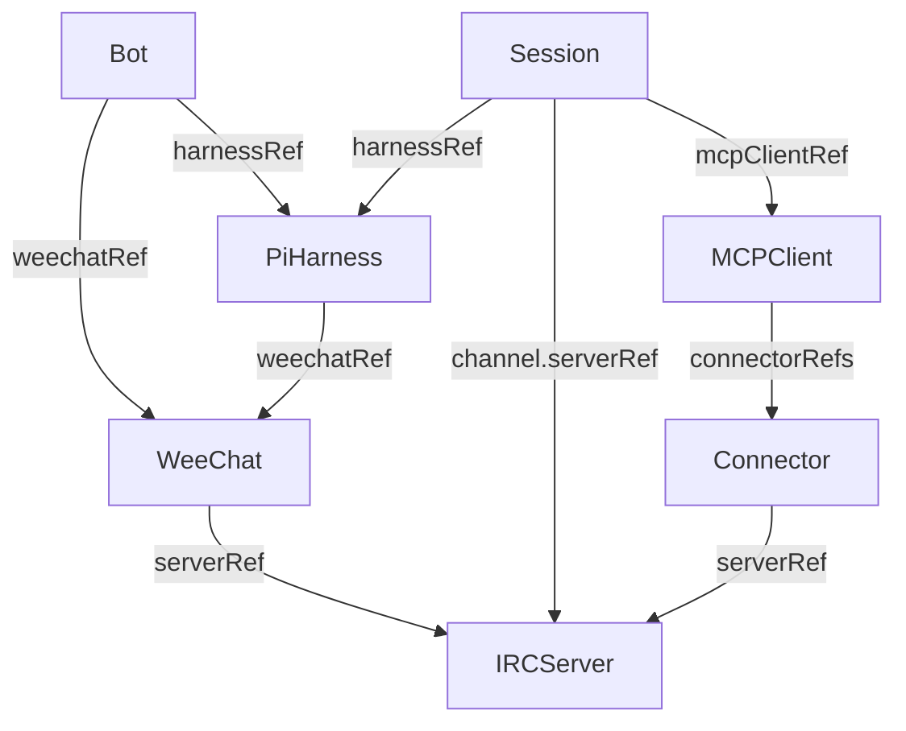

# Canonical IRC/MCP operator: design and plan

Updated 2026-10-18 to make Bot, Session, PiHarness, MCPClient, Connector and WeeChat
independent namespaced CRDs, as requested. This supersedes the initial aggregate-only
API choice. [The original gist](https://gist.github.com/r33drichards/4da908ee769df274a16fa76ea1e1b1ae)
and [preserved source design](history/original-design-and-plan.md) provide history;
the canonical Python dataclasses and the explicit mappings below are the current contract.
Each CRD now has a dedicated desired-state controller. Production provider adapters
remain unconfigured: the default controller reports ready=false and never provisions
resources. The in-memory adapter proves reconciliation behavior in tests only.

## 1. Design

### 1.1 Domain model versus Kubernetes API

[models.py](../src/cuse_operator/models.py) preserves all nine frozen/slotted stdlib
dataclasses and UserId/SessionId NewTypes unchanged. A domain Architecture contains
embedded Python values. Kubernetes resources instead have independent metadata,
spec and status and connect by resource references; they do not duplicate that graph.
Connector's canonical domain fields remain id, server_id, nick, mcp_endpoint. In its
Kubernetes envelope only server_id becomes serverRef; resolving that reference yields
the canonical server ID. ChannelRef remains an inline value, never a CRD.

The provisional API is `cuse.io/v1alpha1`; no ownership of that domain is asserted.
Choose an owned group before a production release. All resources are namespaced.

| Kind | Spec fields | Reference target |
|---|---|---|
| IRCServer | id, endpoint | None; shared InspIRCd intent |
| WeeChat | id, serverRef, nick, mcp_endpoint | IRCServer |
| Connector | id, serverRef, nick, mcp_endpoint | IRCServer |
| MCPClient | id, endpoint, connectorRefs (default []) | Connector collection |
| PiHarness | id, user_id, weechatRef | WeeChat |
| Session | id, harnessRef, channel {serverRef, name}, context_ref, share_url, mcpClientRef | PiHarness, IRCServer, MCPClient |
| Bot | id, weechatRef, harnessRef | WeeChat, PiHarness |
| Architecture | Existing embedded canonical Architecture | Compatibility-only aggregate |

IRCServer is the minimal additional shared CRD required to avoid repeating server
configuration in WeeChat, Connector and Session. Session owns the forward harnessRef;
PiHarness does not also duplicate a sessions array. Sessions can be selected by this
reference when assembling a domain snapshot. MCPClient owns the connectorRefs list;
connectors are separate reusable resources. Bot links existing WeeChat and harness
resources. These are references, not lifecycle ownership or garbage-collection edges.

### 1.2 Reference and identity policy

Every reference is `{name, uid?}`. It resolves in the referencing resource's namespace;
namespace fields in references are rejected by the local validator. There is no
cross-namespace fallback. Optional UID pins detect replacement under the same name;
without a pin, re-creating the named dependency intentionally rebinds the reference.
Names are Kubernetes resource names; id remains the canonical application ID, which
is not restricted to DNS syntax.

Same-kind domain IDs must be unique within a namespace. This is a deliberate explicit
API-level uniqueness scope for independently managed objects; the legacy aggregate's
existing nested ID scopes are unchanged. Different kinds or namespaces may use the
same ID. Duplicate identities block a successful validation result for conflicting
objects and their dependents. Duplicate connector references are invalid. User IDs may
repeat across PiHarness resources. No reverse reference is required, so resources can
be created independently and unused resources are valid if their own references resolve.

A Bot's harness must reference the same WeeChat it links. A Session's channel server
must agree with its harness's WeeChat and all connectors in its MCPClient. All referenced
specs are validated transitively. Missing, deleting or UID-mismatched dependencies
cannot be treated as ready. Deletion never cascades through these references: no
ownerReferences, external teardown or finalizers are created. Dependents are revalidated
and become Blocked or Invalid rather than being deleted.

### 1.3 Validation and status

Strict Python validation rejects unknown/missing fields and type coercion, including
malformed references and nested specs. Scalar/domain policy reuses canonical validation:
nonempty IDs, no surrounding whitespace/controls, minimal IRC channel/nickname rules,
absolute hierarchical endpoint/share URLs, and non-secret context storage references.
Custom URL schemes and internal hosts are accepted; reachability/TLS policy remains
outside this scaffold. Known userinfo/credential parameters are rejected, but no
syntax checker can detect arbitrary opaque secrets; callers must never provide them.

The structural CRD schema specifies every field and item shape. Kubernetes ordinarily
prunes unknown fields; local validation rejects extras before submission. Semantic
validation is currently post-persistence, not admission enforcement. Server-side
strict field validation may reject extras, but must not be assumed universally.

Each split resource has independent status with phase Valid/Invalid/Blocked,
observedGeneration, reason and generic message. Valid means configuration/reference
validation only, not provider readiness. Status never echoes submitted values,
endpoints, secrets or exception text. Architecture retains its original two-state
status and serialized spec unchanged.

### 1.4 Dedicated controllers and provider boundaries

Eight controller modules under `controllers/` cover IRCServer, WeeChat, Connector,
MCPClient, PiHarness, Session, Bot and Architecture. They share reconciliation machinery
but each defines its own desired resource intent and reference inputs. One Kopf process
runs them together; a controller per CRD does not require eight redundant deployments.

Each reconciliation validates the spec/reference graph, constructs a deterministic
revision from desired input and relevant dependency identities/revisions, observes its
provider's actual state, and decides create, update, wait or no-op. Required runtime dependencies must themselves be observed ready at their expected
revision before a child is applied. A matching revision
alone is not sufficient for readiness: the provider must report ready. Generation and
UID scope the observation; a replacement Kubernetes object cannot silently adopt the
previous object's owned state. Changes in dependencies invalidate the desired revision.

The provider interface is explicit and asynchronous. Default `DisabledProvider` reports
`ready=false` / `ProviderNotConfigured`; it does not pretend that validated configuration
is a running server or session. `InMemoryProvider` is a deterministic test adapter that
stores observed state and exercises real desired-versus-observed convergence, drift,
readiness, idempotency and error paths. It is not persisted, production-ready or selected
by the runtime. Concrete opt-in adapters and the fresh Worker runtime are described in
[runtime adapters](runtime-adapters.md); they are disabled without explicit operator configuration.

Provider apply operations use stable UID/revision idempotency keys. Retries observe
before applying again; unknown outcomes must be resolved through observation, never
blindly duplicated. Retryable, terminal and uncertain-outcome errors become generic
status results without copying provider exception details. Provider implementations
must preserve these contracts when introduced.

Status preserves the validation `phase` and adds `ready`, `reconciliationReason`,
`desiredRevision`, `observedRevision`, `lastAction` and `observedGeneration`. Consumers
must use ready plus the current observedGeneration for runtime readiness, never infer it
from phase=Valid. All default runtime providers are unconfigured, so ready stays false.
If a controller itself times out or fails before returning validation, the manager
uses a conservative Invalid/ValidationFailed fallback with ready=false; inspect
reconciliationReason for the actual runtime failure rather than assuming a spec error.

Raw watches dispatch creation/initial listing, spec changes, dependency changes and
deletion to the appropriate controller. Fresh namespace inventories and periodic resync
repair missed changes and retry transient errors. Status-only events are suppressed to
avoid loops. Namespace-scoped serialization and UID/resourceVersion-preconditioned
status merge patches prevent writes over a changed/recreated target. Cross-kind lists
are not atomic snapshots: convergence remains eventual, and this initial implementation
uses namespace-wide scans rather than production-scale reverse indexes.

Deletion calls the matching controller's retain-only deletion path. There is no provider
delete operation, finalizer or ownerReference cascade, so deleting a Bot or Session never
implicitly deletes shared WeeChat, harness, connectors, external data or history. A
future explicit deletion/retention API needs its own review; delete events are best effort
and cannot guarantee cleanup, which is why this version retains everything.

Run one standalone replica scoped to an explicit namespace. RBAC remains custom-resource
reads and status writes only. No workload, Secret, cluster-admin or external-provider permissions.
All API and provider operations use bounded timeouts and generic redacted error logging.
CRD installation remains a separate administrative action. No live cluster was used.

### 1.4.1 Concrete runtime choices and remaining decisions

IRCServer reconciles a managed Deployment/internal Service using an explicitly
selected digest from the user's docker fork. WeeChat owns one bundled weechat-mcp
workload. Connector may reference that owner through optional same-namespace
`weechatRef`; it never duplicates the client. MCPClient runs mcp-js with explicit
policies and existing Secret projections. PiHarness/Session use a fresh Cloudflare
Worker/SQLite DO runtime and authenticated control API; each Session has one root
conversation. Bot is a logical binding. Architecture stays compatibility-only.

Images, actual Secret bindings, model selection, deployment/access, TLS/network
isolation, durable storage policy for Kubernetes workloads, user authorization
and production budgets still require operator choices. No default guesses activate
these effects. [Runtime adapters](runtime-adapters.md) and the
[Worker contract](../runtime/pi/README.md) define precise readiness and limitations.

### 1.5 Backward compatibility and migration

`build_crd()` and `config/crd.json` still describe the original Architecture CRD.
`build_crds()` / `--all` and `config/crds.json` include Architecture plus seven independent
kinds. Existing Architecture resources keep their payload and validation behavior.
Upgrade installations by adding all seven CRDs from config/crds.json and updating
config/rbac.yaml before starting this operator version. The runtime watches all kinds.
Architecture resources are treated as aggregate/import compatibility data only: the operator does not
automatically create, mutate or delete split resources from them. There is therefore
no second controller authority over independently managed resources.

For migration, choose Kubernetes names for domain IDs, create IRCServer/WeeChat/Connector,
then MCPClient/PiHarness, then Session/Bot, and optionally pin resolved UIDs. The example
List is a reference template; no automatic migration or export command is promised.
Review any overlapping IDs and ownership choices before applying. Keep the old aggregate
until the split configuration has been independently validated; deletion is a user choice.

### 1.6 Limits before production

- Semantic admission, size bounds, Kubernetes installation and RBAC integration tests
  remain issue #4. Unbounded aggregate and reference lists still need production size budgets;
  do not use unbounded resource graphs in production.
- Split resources need production-scale indexes, load testing, concurrency/fault testing
  and an explicit leadership strategy before multiple replicas.
- Concrete providers and bounded authenticated protocol probes have offline tests, but no live deployment verification. WeeChat lacks safe upstream IRC proof and remains not-ready. IRC ingress, Pi MCP tools, user authorization and context import remain open.
- Kubernetes specs/status/annotations are not transcript or credential storage.
- Experimental MCP Events require version/capability negotiation and durable delivery;
  notifications alone are not a message queue or proven production protocol.

## 2. Plan

| Work | Tracking | Outcome |
|---|---|---|
| Canonical domain data | [#1](https://github.com/r33drichards/cuse-operator/issues/1) | Frozen types, strict codec and validation |
| Original aggregate scaffold | [#2](https://github.com/r33drichards/cuse-operator/issues/2) | Backward-compatible Architecture API |
| Initial docs and CI | [#3](https://github.com/r33drichards/cuse-operator/issues/3) | Verified scaffold publication |
| Split resource API | [#9](https://github.com/r33drichards/cuse-operator/issues/9) | Six requested kinds, shared IRCServer, references and watches |
| Dedicated per-kind controllers | [#10](https://github.com/r33drichards/cuse-operator/issues/10) | Desired/observed convergence, provider boundary and lifecycle dispatch |
| Admission/version hardening | [#4](https://github.com/r33drichards/cuse-operator/issues/4) | API-server semantic protection and integration verification |
| Kubernetes providers | [#5](https://github.com/r33drichards/cuse-operator/issues/5) | Pure workload plans and idempotent provider adapters |
| Pi/MCP runtime | [#6](https://github.com/r33drichards/cuse-operator/issues/6) | Durable session mappings and scoped tools |
| Cloudflare delivery | [#7](https://github.com/r33drichards/cuse-operator/issues/7) | Authenticated routing and durable inbox/outbox |
| MCP Events experiment | [#8](https://github.com/r33drichards/cuse-operator/issues/8) | Versioned capabilities, failure tests and fallback |

Remaining production integration stages are tracked in issue #11. Issue tracking is not approval for
production edits, resource deletion, new access grants or deployments. Before a live
test agree on a disposable namespace/cluster, permissions, budgets and cleanup.

### References

- [Kopf handlers](https://docs.kopf.dev/en/stable/handlers/)
- [Kopf configuration](https://docs.kopf.dev/en/stable/configuration/)
- [Kubernetes CustomResourceDefinitions](https://kubernetes.io/docs/tasks/extend-kubernetes/custom-resources/custom-resource-definitions/)

## Source-backed runtime implementation update

The [runtime adapter design](runtime-adapters.md) is the current implementation
boundary for concrete providers. IRCServer uses the user-selected docker fork
and a managed Deployment/internal Service. Connector means a downstream MCP
server for mcp-js, including WeeChat MCP implemented by weechat-mcp. The additive,
reviewable optional Connector.weechatRef links to the one owning WeeChat runtime;
it must match server, nickname and endpoint, and never creates a duplicate client.
MCPClient desired plans now include resolved downstream names and URLs.

PiHarness and Session target fresh Cloudflare Workers + SQLite Durable Object
implementations based on the selected Pi Durable reference, not existing Cuse
runtime. Kopf manages declarative desired state through an authenticated runtime
control API; no Cloudflare deployment or account/credential changes are implied.
The original canonical dataclasses remain unchanged.
