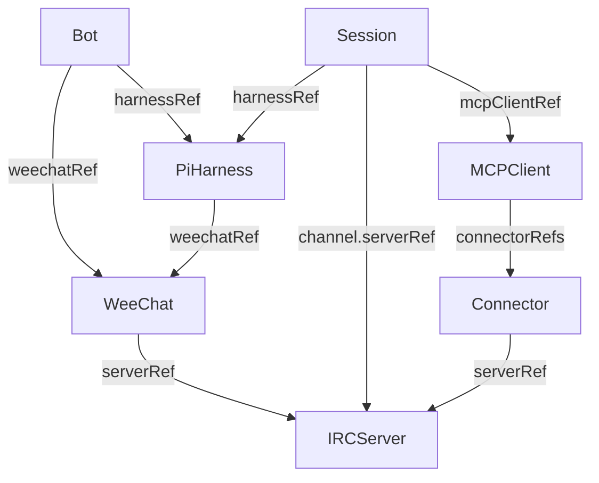

# Canonical IRC/MCP operator: design and plan

Updated 2026-10-17 to make Bot, Session, PiHarness, MCPClient, Connector and WeeChat
independent namespaced CRDs, as requested. This supersedes the initial aggregate-only
API choice. [The original gist](https://gist.github.com/r33drichards/4da908ee769df274a16fa76ea1e1b1ae)
and [preserved source design](history/original-design-and-plan.md) provide history;
the canonical Python dataclasses and the explicit mappings below are the current contract.
This remains a validation-only scaffold, not a provisioning system.

## 1. Design

### 1.1 Domain model versus Kubernetes API

[models.py](../src/cuse_operator/models.py) preserves all nine frozen/slotted stdlib
dataclasses and UserId/SessionId NewTypes unchanged. A domain Architecture contains
embedded Python values. Kubernetes resources instead have independent metadata,
spec and status and connect by resource references; they do not duplicate that graph.
Connector's canonical domain fields remain id, server_id, nick, mcp_endpoint. In its
Kubernetes envelope only server_id becomes serverRef; resolving that reference yields
the canonical server ID. ChannelRef remains an inline value, never a CRD.

The provisional API is `cuse.io/v1alpha1`; no ownership of that domain is asserted.
Choose an owned group before a production release. All resources are namespaced.

| Kind | Spec fields | Reference target |
|---|---|---|
| IRCServer | id, endpoint | None; shared InspIRCd intent |
| WeeChat | id, serverRef, nick, mcp_endpoint | IRCServer |
| Connector | id, serverRef, nick, mcp_endpoint | IRCServer |
| MCPClient | id, endpoint, connectorRefs (default []) | Connector collection |
| PiHarness | id, user_id, weechatRef | WeeChat |
| Session | id, harnessRef, channel {serverRef, name}, context_ref, share_url, mcpClientRef | PiHarness, IRCServer, MCPClient |
| Bot | id, weechatRef, harnessRef | WeeChat, PiHarness |
| Architecture | Existing embedded canonical Architecture | Compatibility-only aggregate |

IRCServer is the minimal additional shared CRD required to avoid repeating server
configuration in WeeChat, Connector and Session. Session owns the forward harnessRef;
PiHarness does not also duplicate a sessions array. Sessions can be selected by this
reference when assembling a domain snapshot. MCPClient owns the connectorRefs list;
connectors are separate reusable resources. Bot links existing WeeChat and harness
resources. These are references, not lifecycle ownership or garbage-collection edges.

### 1.2 Reference and identity policy

Every reference is `{name, uid?}`. It resolves in the referencing resource's namespace;
namespace fields in references are rejected by the local validator. There is no
cross-namespace fallback. Optional UID pins detect replacement under the same name;
without a pin, re-creating the named dependency intentionally rebinds the reference.
Names are Kubernetes resource names; id remains the canonical application ID, which
is not restricted to DNS syntax.

Same-kind domain IDs must be unique within a namespace. This is a deliberate explicit
API-level uniqueness scope for independently managed objects; the legacy aggregate's
existing nested ID scopes are unchanged. Different kinds or namespaces may use the
same ID. Duplicate identities block a successful validation result for conflicting
objects and their dependents. Duplicate connector references are invalid. User IDs may
repeat across PiHarness resources. No reverse reference is required, so resources can
be created independently and unused resources are valid if their own references resolve.

A Bot's harness must reference the same WeeChat it links. A Session's channel server
must agree with its harness's WeeChat and all connectors in its MCPClient. All referenced
specs are validated transitively. Missing, deleting or UID-mismatched dependencies
cannot be treated as ready. Deletion never cascades through these references: no
ownerReferences, external teardown or finalizers are created. Dependents are revalidated
and become Blocked or Invalid rather than being deleted.

### 1.3 Validation and status

Strict Python validation rejects unknown/missing fields and type coercion, including
malformed references and nested specs. Scalar/domain policy reuses canonical validation:
nonempty IDs, no surrounding whitespace/controls, minimal IRC channel/nickname rules,
absolute hierarchical endpoint/share URLs, and non-secret context storage references.
Custom URL schemes and internal hosts are accepted; reachability/TLS policy remains
outside this scaffold. Known userinfo/credential parameters are rejected, but no
syntax checker can detect arbitrary opaque secrets; callers must never provide them.

The structural CRD schema specifies every field and item shape. Kubernetes ordinarily
prunes unknown fields; local validation rejects extras before submission. Semantic
validation is currently post-persistence, not admission enforcement. Server-side
strict field validation may reject extras, but must not be assumed universally.

Each split resource has independent status with phase Valid/Invalid/Blocked,
observedGeneration, reason and generic message. Valid means configuration/reference
validation only, not provider readiness. Status never echoes submitted values,
endpoints, secrets or exception text. Architecture retains its original two-state
status and serialized spec unchanged.

### 1.4 Reconciliation and dependency updates

Architecture retains its original create/update/resume validation handler and annotation
persistence. Split resources use low-level watches; a meaningful resource event triggers
a fresh namespace-scoped inventory of the split kinds and revalidates that namespace.
Dependency deletion, invalidation, ID collisions and later repairs are consequently
reflected in dependent statuses. Status-only changes are ignored to avoid loops.
A periodic resync retries transient failures and missed work. The implementation is a
validation scaffold with namespace-wide scans, not a production-scale indexed controller.

Status patches carry resource identity/version preconditions to avoid overwriting a
newer spec or a replacement object's status. Concurrent namespace changes are eventually
consistent; a list across several kinds is not an atomic Kubernetes snapshot. Watch and
resync repair temporary observations. API failures do not mean dependencies are absent.
The controller does not provision workloads, probe endpoints, start sessions, configure
connectors or change external providers.

Run one standalone replica scoped to an explicit namespace. Runtime RBAC permits only
get/list/watch of the CRDs, status patches, and Architecture annotation patches needed
by Kopf. No Secret, workload, cluster-admin, peering or external-provider privileges.
Initial discovery relies on standard authenticated discovery permissions. CRD installation
is a separate administrative action. No live cluster or RBAC test has been performed.

### 1.5 Backward compatibility and migration

`build_crd()` and `config/crd.json` still describe the original Architecture CRD.
`build_crds()` / `--all` and `config/crds.json` include Architecture plus seven independent
kinds. Existing Architecture resources keep their payload and validation behavior.
Upgrade installations by adding all seven CRDs from config/crds.json and updating
config/rbac.yaml before starting this operator version. The runtime watches all kinds.
They are treated as aggregate/import compatibility data only: the operator does not
automatically create, mutate or delete split resources from them. There is therefore
no second controller authority over independently managed resources.

For migration, choose Kubernetes names for domain IDs, create IRCServer/WeeChat/Connector,
then MCPClient/PiHarness, then Session/Bot, and optionally pin resolved UIDs. The example
List is a reference template; no automatic migration or export command is promised.
Review any overlapping IDs and ownership choices before applying. Keep the old aggregate
until the split configuration has been independently validated; deletion is a user choice.

### 1.6 Limits before production

- Semantic admission, size bounds, Kubernetes installation and RBAC integration tests
  remain issue #4. Architecture's diff-base annotations can exceed annotation limits
  for large specs; do not use unbounded aggregates in production.
- Split resources need production-scale indexes, load testing, concurrency/fault testing
  and an explicit leadership strategy before multiple replicas.
- No endpoint health, workload management, secret handling or external execution exists.
- Kubernetes specs/status/annotations are not transcript or credential storage.
- Experimental MCP Events require version/capability negotiation and durable delivery;
  notifications alone are not a message queue or proven production protocol.

## 2. Plan

| Work | Tracking | Outcome |
|---|---|---|
| Canonical domain data | [#1](https://github.com/r33drichards/cuse-operator/issues/1) | Frozen types, strict codec and validation |
| Original aggregate scaffold | [#2](https://github.com/r33drichards/cuse-operator/issues/2) | Backward-compatible Architecture API |
| Initial docs and CI | [#3](https://github.com/r33drichards/cuse-operator/issues/3) | Verified scaffold publication |
| Split resource API | [#9](https://github.com/r33drichards/cuse-operator/issues/9) | Six requested kinds, shared IRCServer, references and watches |
| Admission/version hardening | [#4](https://github.com/r33drichards/cuse-operator/issues/4) | API-server semantic protection and integration verification |
| Kubernetes providers | [#5](https://github.com/r33drichards/cuse-operator/issues/5) | Pure workload plans and idempotent provider adapters |
| Pi/MCP runtime | [#6](https://github.com/r33drichards/cuse-operator/issues/6) | Durable session mappings and scoped tools |
| Cloudflare delivery | [#7](https://github.com/r33drichards/cuse-operator/issues/7) | Authenticated routing and durable inbox/outbox |
| MCP Events experiment | [#8](https://github.com/r33drichards/cuse-operator/issues/8) | Versioned capabilities, failure tests and fallback |

Later provider/runtime stages remain deferred. Issue tracking is not approval for
production edits, resource deletion, new access grants or deployments. Before a live
test agree on a disposable namespace/cluster, permissions, budgets and cleanup.

### References

- [Kopf handlers](https://docs.kopf.dev/en/stable/handlers/)
- [Kopf configuration](https://docs.kopf.dev/en/stable/configuration/)
- [Kubernetes CustomResourceDefinitions](https://kubernetes.io/docs/tasks/extend-kubernetes/custom-resources/custom-resource-definitions/)
