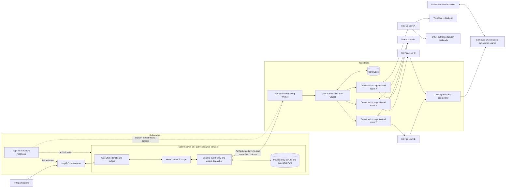
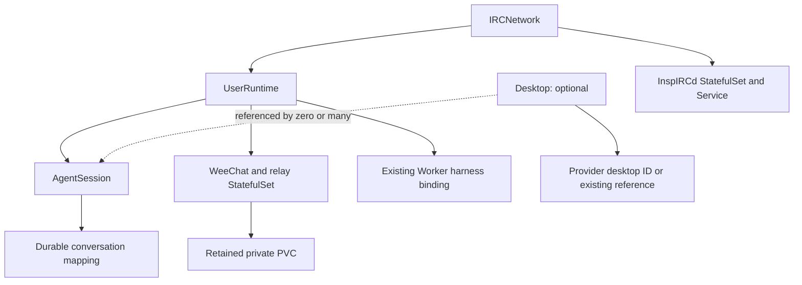
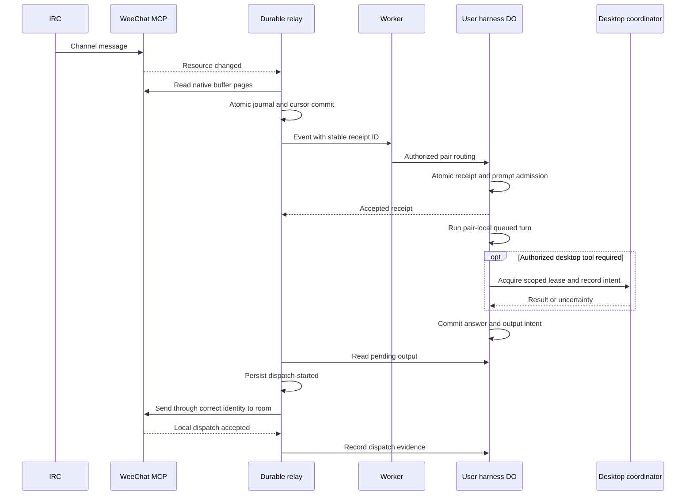
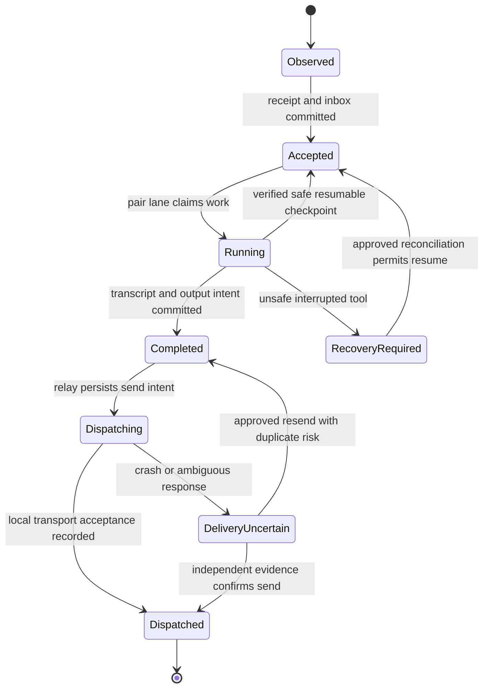

> Historical source, superseded for implementation by [the current design](../design-and-plan.md) and canonical models. Preserved from the user-authorized [gist](https://gist.github.com/r33drichards/4da908ee769df274a16fa76ea1e1b1ae) on 2026-10-17. Original PDF/PNG/base64 attachments are not included here. References below to gist-only files remain historical. Older resource APIs and Desktop/ToolBackend proposals are not implemented contracts.

# Kopf operator for durable IRC agents and optional desktops

Reference design, 2026-10-17. This is an implementation specification and staged plan, not a deployed system. The original one-page architecture PDF and latest updated PNG are preserved losslessly in this gist; see `02-restore-originals.py`. The updated PNG takes precedence wherever the drawings differ. Secret gists are unlisted, not access-controlled: anyone with the URL can read and copy them. No credentials or private viewer URLs belong here.

## 1. Design

### 1.1 Goal and interpretation of the original and updated diagrams

Build a Kubernetes control plane using Python/Kopf for an always-on IRC service and per-user WeeChat MCP runtimes. Route events into a Cloudflare Worker and durable Pi harnesses. Agent conversations may use no desktop, a dedicated desktop, or an explicitly shared Computer Use desktop. Reconcile infrastructure without making Kubernetes the message queue or agent scheduler.

The supplied PDF shows:

- One always-on InspIRCd container.
- A stack of always-on WeeChat MCP containers, one per user, each holding its user's IRC identity, channel membership and native buffer state.
- MCP events triggering a Cloudflare function.
- A Pi harness per user, containing several session boxes.
- Bidirectional connections from those sessions to Computer Use JavaScript desktops.
- A footer describing a Worker routing by session ID to a SQLite-backed Durable Object, with hibernatable WebSockets, conversations and tasks, and Pi Durable calling a model provider. The same session URL reaches the same object.

The updated PNG adds a distinct per-session MCP.js client between each Pi conversation and its backend tools. Computer use.js and WeeChat.js are legible backend labels; two other labels are unclear and are represented only as generic plugin backends. A desktop is an optional resource referenced through a tool binding, not a mandatory session child. This newer topology supersedes direct session-to-desktop arrows in the PDF. The control-plane APIs, durable bridge/outbox, tenant authentication, desktop coordination and recovery protocols below are proposed additions needed to make it operable. Python dataclasses in `agent_design_types.py` express this topology; they are a reference model, not deployed CRDs or a claim that upstream exposes these types.

**Terminology must be explicit:** the Earendil sample's *session* is a harness/storage boundary that can contain multiple conversations. An IRC *agent session* is the pair `(AgentId, ChannelId)`, with its own transcript and execution lane. A Computer Use *session* is a desktop resource. These IDs must never be interchanged.

### 1.2 End-to-end architecture



The diagram deliberately keeps WeeChat and IRC running even while a harness or desktop sleeps. The relay is an application process with a durable local journal; resource-change notifications alone are not durable message delivery. Prefer outbound authenticated connections from Kubernetes to the Worker, avoiding public access to per-user MCP servers.

A single `UserRuntime` initially has one WeeChat profile and one transport identity, exactly as the PDF. If a user operates multiple independently speaking agents, extend it to a profile per AgentId or an `AgentTransport` child resource; several MCP connections to one profile still share one IRC identity. Do not claim multiple nicknames merely by multiplying model conversations. The resource contract reserves `transportIdentityRef` so this extension does not rekey history.

### 1.3 Identity and state ownership

| Concept | Stable key and owner | Rules |
|---|---|---|
| Tenant | application-issued tenant ID | Authentication maps credentials to tenant; never accept tenant identity from an IRC message. |
| IRC network | immutable `IRCNetwork.metadata.uid` plus approved network identity | A new endpoint/network requires a migration; avoid joining unrelated networks into the same history. |
| Agent | immutable application AgentId with transport binding | Nick is a mutable display/routing address, not the database key. |
| Channel | network ID + server CASEMAPPING-normalized channel | Preserve display spelling. Persist normalization version; reject collisions. Lowercase alone is insufficient for all IRC casemappings. |
| Agent session | tenant + network + AgentId + canonical ChannelId + incarnation | One transcript, prompt FIFO, schedules, goals and receipts. A recreated CR must not silently adopt an older incarnation. |
| Harness | tenant + stable harness ID | Proposed v1: one DO/harness per user, multiple pair-local conversations. |
| Conversation | harness-owned ConversationId | Mapping from AgentSession to conversation is durable and immutable during normal reconcile. |
| Desktop | provider account + actual desktop ID | Multiple sessions can reference one resource; ownership and authorization are separate. |
| Reply | agent transport identity + network + destination + output ID | Preserve source room at admission, independent of current membership/default room. |

**Proposed placement decision:** one user harness DO holds that user's pair-local conversations, matching “Pi harness per user.” The sample uses one DO per sample session; this proposal treats that session as the user harness, not as a single IRC channel. This is a failure/storage boundary, not an assertion of unlimited per-user throughput. Shard to one harness per agent or pair only after load testing and an explicit mapping migration. Do not map one DO per pair and call it the same architecture without documenting the difference.

Within a user harness, conversations are isolated by application authorization and tool scope. The sample's cross-conversation search tool must be disabled by default or filtered to an explicit authorized scope. A shared harness/database is not a strong security sandbox between hostile tenants. Never put different security tenants into one DO. A shared desktop/file tree also intentionally shares information and cannot provide transcript-level confidentiality for files.

Runtime source of truth:

- Kubernetes `spec`: infrastructure intent and permitted bindings.
- Kubernetes `status`: observed generation, readiness, opaque non-secret provider IDs, conditions and sanitized failure summaries.
- Relay database: native intake positions, gap flags, event delivery receipts and outgoing dispatch journal.
- Pi storage: conversations, tasks, prompt receipts, inbox/outbox, session mapping and scheduling state.
- Desktop coordinator: active resource lease/operation journal and fencing generation.
- Computer Use: actual desktop state and disk/process lifecycle.

Never store messages, model prompts, transcripts, tokens, screenshots, cookies or per-tool task updates in CR status. Do not have both the operator and the agent runtime independently create or sleep the same desktop.

### 1.4 Resource API and dependency graph

Names below use the placeholder API group `agents.example.com/v1alpha1`; replace it with an owned domain before release. All four resources are namespaced for v1. One tenant namespace is the default isolation unit. References contain `name` and `uid`, resolve only in the same namespace, and fail on missing/recreated/terminating dependencies. No cross-namespace secret references.



Arrows indicate dependency, not necessarily garbage-collection ownership. Shared desktops and retained data must not be cascade-deleted with a referencing session. Kubernetes-owned disposable workloads may use ownerReferences; retained PVCs and external resources need explicit retention handling.

**IRCNetwork**

- `spec.image`: mandatory immutable image digest built from reviewed InspIRCd source.
- `spec.serverName`, `networkID`, `tlsSecretRef`, `configRef`, `storageClassName`, `storageSize`, `service` exposure policy.
- `spec.replicas`: fixed at 1 for v1. A single server is a deliberate availability limit; do not scale replicas against the same server identity/configuration.
- `spec.deletionPolicy`: `Retain` for data. Teardown of a live network is separately approved.
- Status: Service DNS, workload UID, config hash, Ready/Degraded/Reconciling, observedGeneration.
- Validate server name, ports, resource budgets, TLS config and fixed identity. Config changes go through a validated config render and controlled reload/restart. Never interpolate raw CR strings into shell commands.

**UserRuntime**

- `spec.userID`, `networkRef`, `transportIdentityRef`, `image` digest, `channels`, `weechatSecretRef`, `relayCredentialRef`, `workerBindingRef`, `storage`, `limits`, `deletionPolicy: Retain`.
- One active writer per private WeeChat home/PVC and transport identity. Persist WeeChat configuration separately from the relay WAL; use process supervision that terminates both on failure.
- `workerBindingRef` references an already deployed, authenticated Worker. v1 operator does not deploy Worker code or create broad Cloudflare access grants.
- Start WeeChat + MCP and relay, verify subscription acknowledgement, persist catch-up checkpoint, then mark ready. Readiness is not merely “Python process exists.”
- The upstream container applies IRC environment bootstrap on first persistent-home boot only. Reconcile ongoing membership via explicit supported configuration/commands with readback; do not expect changing env vars to replace saved configuration.

**AgentSession**

- `spec.runtimeRef`, `agentID`, `channel`, `personaRef`, `wakePolicy`, `desktopBinding`, `retention`, resource budgets.
- `desktopBinding` is a tagged union: `{mode: None}`, `{mode: Managed, desktopRef: {name, uid}}`, or `{mode: Existing, desktopRef: {name, uid}}`. None must not create a desktop or require its credentials.
- Immutable at v1: runtime/network, agent ID, canonical channel, incarnation and desktop binding. Rebinding interrupted work needs a future explicit migration operation, not an innocent spec edit.
- Status: harnessID, conversationID, mapping generation, readiness and blocked reason. No transcript.
- Session creation registers/looks up the durable pair mapping using a stable request ID and validates its existing value. Deletion closes new admission and retains history; it must not delete a shared desktop.

**Desktop**

- `spec.provider: ComputerUse`, `mode: Managed|Existing`, `existingID` only for Existing, `size` only for Managed, `sharing: Exclusive|Shared`, `allowedRuntimeRefs`, `providerCredentialRef`, `desiredState`, `deletionPolicy: Retain`.
- Existing grants attachment/use/status only, never ownership to recreate, sleep, stop, snapshot or delete.
- Managed records owner UID and deterministic provider name. Before create, write a durable intent. A timeout after POST means uncertain creation: list/reconcile by name, stop on duplicate/absent result, and never blindly POST again.
- `sharing: Shared` requires a resource coordinator for all tool calls and lifecycle mutations. Model-local mutexes do not coordinate two DOs/deployments.
- Desktops continue to have independent bills and lifecycle. A count quota is not a financial cap. Budget, idle-policy and cleanup decisions require explicit operator policy.

Example proposed resources (illustrative schema; not installable CRDs):

```yaml
apiVersion: agents.example.com/v1alpha1
kind: AgentSession
metadata:
  name: research-in-wchat
  namespace: tenant-demo
spec:
  runtimeRef: {name: user-runtime, uid: REPLACE_WITH_RUNTIME_UID}
  agentID: research-agent
  channel: '#wchat'
  wakePolicy: {mode: Mention, maxQueuedTurns: 100, peerTurnBudget: 8}
  desktopBinding:
    mode: None
  retention: Retain
---
apiVersion: agents.example.com/v1alpha1
kind: Desktop
metadata:
  name: shared-research-desktop
  namespace: tenant-demo
spec:
  provider: ComputerUse
  mode: Existing
  existingID: REPLACE_WITH_APPROVED_DESKTOP_ID
  sharing: Shared
  allowedRuntimeRefs:
    - {name: user-runtime, uid: REPLACE_WITH_RUNTIME_UID}
  providerCredentialRef: {name: computer-use, key: token}
  deletionPolicy: Retain
```

The API server structural schema must reject unknown fields, bound list/string sizes, enforce tagged-union fields and immutable identity fields via CEL or validating admission. The handler's preflight validation alone cannot prevent an invalid spec being persisted. Secrets are independently provisioned; CR authors cannot choose arbitrary privileged secrets. Apply namespace RBAC and an allowlisted credential reference policy.

### 1.5 Reconcile algorithm and Kopf responsibilities

Implement one pure desired-state planner and narrow provider adapters. Register create/update/resume handlers and periodic drift checks; use watches/indexes for dependency changes. Resume must repair missed work after restart. Timers are a safety net, not a millisecond message scheduler. Use documented Kopf errors/backoff and one active operator leader (or properly configured peering/coordination) per scope. [Kopf reconciliation](https://docs.kopf.dev/en/stable/reconciliation/) and [peering](https://docs.kopf.dev/en/stable/peering/).

For each reconciliation:

1. Read UID, generation, deletion timestamp and validated spec. Read referenced dependencies and confirm UID plus current Ready generation.
2. Build a canonical desired plan and spec hash. Read actual child/provider state. Never trust an old `Ready=True` as evidence for a new generation.
3. Before an external side effect, persist operation intent `{resourceUID, generation, operationID, target, desiredHash, phase}` in the provider operation ledger. Use stable keys for retries and reject request-ID reuse with differing payload hashes.
4. Apply deterministic Kubernetes manifests using server-side apply with a dedicated field manager. Avoid forcing conflicts with human-owned fields. Labels include owner UID, tenant and component; do not adopt similarly named foreign objects.
5. Call provider adapter only for missing or drifted state. Existing-resource references remain read-only. Retry transient read errors with bounded backoff. Treat ambiguous writes as `RecoveryRequired`, not as retryable create errors.
6. Read back operation results and actual readiness. If generation changed during work, retain its receipt but requeue against latest intent; never mark the new generation ready using old results.
7. Patch status only on semantic change, with standard condition fields: type, status, reason, sanitized message, lastTransitionTime, observedGeneration. Emit bounded sanitized events/metrics.

Infrastructure reconciliation should remain safe under duplicate delivery, pod restart, optimistic-concurrency conflict and partial provider failure. Handler retries are not proof of external exactly-once execution. Use small time-bounded operations; no indefinitely running model turn inside a handler.

Deletion uses a finalizer: stop new admission, drain or mark unresolved operations, detach referencing sessions, retain data/provider resources by default, record retained IDs in an operator-visible inventory, remove the finalizer after safe detachment. Do not wait forever for optional external cleanup when Retain is requested. Destructive purge requires a separate approved workflow. Kubernetes object deletion must not implicitly destroy paid desktops, logs or shared histories.

### 1.6 Events, context and output delivery

The WeeChat plugin owns IRC and native buffers. Its Python bridge exposes MCP tools/resources. Its current resource notifications tell a consumer to reread a buffer; they do not directly wake a model. Native history is bounded/in-memory and normal WeeChat process restart does not restore it through this adapter. Stable persistent WeeChat config does not make all channel history durable. [Verified WeeChat MCP source](https://github.com/r33drichards/weechat-mcp/tree/7d934730d6b6864a937035201f6caa039b080792).

Relay intake algorithm:

1. Authenticate to the private MCP endpoint, initialize the pinned protocol, discover resources and create acknowledged `subscriptions/listen` streams.
2. Subscribe before completing catch-up, then reread and deduplicate to close the read/subscribe race. Resource notifications may be duplicated/coalesced. Maintain `(runtimeID, networkID, buffer, dataEpoch, nativeLineID)` as transport position, not a timestamp-only watermark.
3. Read pages in native insertion order. Native IDs may be sparse. Inspect omission/retention metadata rather than assuming every integer exists. An expired cursor/lifetime change forces explicit resynchronization and gap status.
4. In one local SQLite transaction, persist observed eligible lines and advance the verified cursor. Keep observation separate from turn admission. Apply IRC-message/tag filtering and ignore self echoes/control/status lines as prompts.
5. Create per-recipient receipts using transport position plus AgentId and mapping incarnation. One IRC message legitimately yields distinct receipts for two agents. Match exact nickname/address policy; enforce peer-loop, queue and rate budgets.
6. Submit through authenticated Worker with the same stable request ID until durably acknowledged. Worker resolves the tenant/agent/room mapping server-side and rejects mismatches. A receipt commits with prompt admission; no ACK before durable acceptance.
7. The runtime serializes turns per pair. Distinct pairs may run concurrently subject to budgets and any separate shared-desktop lock. Unaddressed room history can be retained under a bounded, documented retention policy without triggering turns.

Proposed envelope, not an existing public upstream endpoint:

```json
{
  "version": 1,
  "eventId": "stable-receipt-id",
  "runtimeId": "opaque-runtime-id",
  "agentId": "research-agent",
  "networkId": "opaque-network-id",
  "channelId": "canonical-room-id",
  "mappingGeneration": 1,
  "position": {"buffer": "irc.network.#wchat", "dataEpoch": "opaque-epoch", "lineId": "123"},
  "sender": {"nick": "participant", "account": null},
  "kind": "irc.message",
  "text": "research-agent: investigate the issue",
  "receivedAt": "2026-10-17T00:00:00Z"
}
```

`sender.account` is evidence only if authenticated IRC services/capabilities establish it. A nickname, mention or peer-agent message never grants user authority for consequential tools. Worker credentials authenticate the relay; user/action authorization is checked separately.



Outbox records include output ID, receiving agent identity, destination, content hash, chunk numbering and dispatch state. Persist output creation atomically with turn completion. The dispatcher polls/streams committed outputs using cursors and deduplicates output IDs. Bound IRC message chunks and flood rate. After a crash between dispatch and confirmation, mark `DeliveryUncertain`; IRC has no general idempotency key that makes resend safe. Never claim “delivered/read/executed” merely because WeeChat accepted a local command. A replayed output notification must not resend a known completed output.

Proposed app-owned routes: `POST /internal/v1/events`, `GET /internal/v1/outputs?after=...`, `POST /internal/v1/outputs/{id}/receipt`, and `PUT /internal/v1/bindings/{operationID}`. Define JSON schemas, tenant authorization, payload limits, idempotency conflict errors, pagination and response codes before implementing. These routes do not exist in the Earendil sample and must not be presented as upstream APIs.

### 1.6a Experimental MCP Events compatibility

The supplied [MCP Events design sketch](https://github.com/modelcontextprotocol/experimental-ext-triggers-events/blob/d5316be214be2e76e51462069c1d67e00a5a7619/docs/design-sketch-proposal.md) is pinned at `d5316be214be2e76e51462069c1d67e00a5a7619`. It is explicitly a draft proposal, not proof that the current WeeChat MCP server implements `events/*`. Keep its adapter behind capability detection and a feature flag; the initial working path remains the verified resource subscription plus durable relay.

The proposed protocol discovers event types and schemas with `events/list`. Delivery is negotiated per event type: polling, a request-scoped push stream, or signed HTTPS webhooks. The client retains subscription intent and cursors; webhook leases must be refreshed before their granted deadline. Event IDs support deduplication; cursors support replay only when the upstream has retained history. Gaps must remain visible. The proposal deliberately does not guarantee global ordering, exactly-once delivery or transactional consistency. Event receipt never authorizes a consequential action.

Our adapter must converge all enabled transports on the same journal and canonical receipt identity. Preserve the original event ID across push delivery and poll backfill. Use retained upstream order when available; otherwise record explicitly that arrival order is the only known order. A webhook success response follows durable admission, never merely receipt in memory. Webhook authentication, body integrity, replay-window checks, callback verification, SSRF defenses and per-tenant quotas are implementation gates, not optional UI features. Avoid registering arbitrary user-provided callback destinations; use approved application endpoints.

Tests must cover missing capability fallback; overlapping push and poll replay; cursor expiry and truncation; lost webhook responses; expired/revoked subscription; changed schema; tenant mismatch; duplicate ID with conflicting content; signature failure and callback abuse. Pin the proposal separately from server implementation and update it only through reviewed compatibility changes. Do not rename the currently implemented `subscriptions/listen` API to `events/stream` on paper.

### 1.7 Pi Durable and Cloudflare integration

The verified sample provides a concrete starting point: one named DO/harness with SQLite, multiple conversations, restored WebSocket views and alarm-based task recovery. Its Worker creates session IDs and routes WebSocket connections; its sample has no production authentication. Reuse its adapter and tests, then add tenant authorization and the relay API rather than inventing an incompatible storage layer. [Blog](https://earendil.com/posts/pi-durable-on-cloudflare/), [pinned sample](https://github.com/earendil-works/pi-durable-cloudflare/tree/dcb56ce2d174babb3f00112ac5b8cd597e58ab45).

Implementation contracts:

- On construction, initialize `openDurableObjectSqliteStorage(ctx.storage)` and `Harness.open(...)` under `blockConcurrencyWhile`. Rebuild ephemeral subscriptions/maps from persisted state. Abort/reset a failed harness storage instance rather than pretending it is healthy.
- Register agent/channel mapping as an application document in a commit that also records creation receipt. Stable IDs survive retry. Validate existing receipt command and payload before returning it.
- Submit pair prompts using `requestId` and `whenBusy: "followUp"`; map each AgentSession to its own ConversationId. Use the pinned package API, not an invented scheduler.
- Use native hibernating WebSockets and serialized attachment metadata only for non-secret connection scope. Revalidate authorization on reconnect/revocation; restore authorized stream subscriptions after wake. Sleeping does not preserve arbitrary JavaScript globals. [Cloudflare WebSockets](https://developers.cloudflare.com/durable-objects/best-practices/websockets/).
- Maintain the minimum pending deadline across scheduled work plus a recovery wake for unfinished tasks. Serialize alarm updates; persist the recovery wake before activating work. Recalculate from persisted tasks on alarm and settlement. Alarms can execute at least once, so use stable schedule receipt IDs and idempotent handlers. [Cloudflare alarms](https://developers.cloudflare.com/durable-objects/api/alarms/).
- Classify each tool's replay semantics. Read-only retrieval can be safe; clicks, payments, IRC sends and arbitrary shell commands are not automatically replay-safe. Interrupted writes require read-only reconciliation or a visible unresolved result.
- Disable unconstrained sample conversation search. A search subagent gets an explicit allowlisted conversation set and only retrieval tools; it must not search private contexts just because they share storage.
- Model/provider credentials stay in host/Worker secret facilities. Existing Cuse's admin OAuth setup must not be silently converted to an API-key billing model merely because the demo uses an OpenAI API key. Provider choice, credential custody and service terms are a migration decision.

The existing Cuse runtime is already durable. At the pinned main revision, per-agent/per-room session boundaries, pair-local queues and optional/shared desktop attachments are implemented. It still uses home-backed agent identities; ordinary room observation independent of mentions and cross-process desktop workflow coordination remain gaps. Preserve its durable semantics and tests during the Cloudflare port. Do not pitch this as “add durability to an ephemeral Cuse bot.” [Current Cuse design](https://github.com/r33drichards/cuse/blob/d9760ceb7eba7f94a67c46b0e28d6bb5e0bff51f/docs/agent-channel-sessions.md).

### 1.8 Computer Use adapter and shared-resource control

The service at [computeruse.site](https://computeruse.site) exposes resumable desktops and code-mode MCP. An agent receives `run_js` and discovers underlying capabilities rather than receiving a guessed set of browser functions. Start from the [MCP reference](https://computeruse.site/reference/mcp), [lifecycle reference](https://computeruse.site/reference/lifecycle) and [current capabilities](https://computeruse.site/reference/capabilities). The verified Cuse adapter is [src/computer-use.ts](https://github.com/r33drichards/cuse/blob/d9760ceb7eba7f94a67c46b0e28d6bb5e0bff51f/src/computer-use.ts).

Observed Cuse client contract, not a promise that every endpoint is publicly stable:

| Operation | Current adapter request |
|---|---|
| List/create desktops | `GET /v1/sessions`; `POST /v1/sessions` with `{name,size}` |
| Read/delete desktop | `GET /v1/sessions/{id}`; `DELETE /v1/sessions/{id}` |
| Sleep/wake | `POST /v1/sessions/{id}/sleep` or `/wake`, JSON `{}` |
| Stop/resume | `PATCH /v1/sessions/{id}` with `{action:"stop"}` or `{action:"resume"}` |
| MCP | `POST /{id}/mcp` on `https://api.computeruse.site` |
| Human viewer | `https://app.computeruse.site/sessions/{id}`; share only with authorized viewers |

The host attaches bearer credentials, JSON-RPC IDs, negotiated MCP protocol and `Mcp-Session-Id`; accepts JSON/SSE responses and correlates IDs. Cuse starts desktop MCP negotiation at `2025-06-18`, distinct from WeeChat MCP's pinned `2026-07-28`. Do not force both transports to a single hard-coded protocol version.

Safe retry rules: explicit pre-execution wake response 425 may be retried within a deadline; generic 504/timeouts/network errors may follow execution and must not trigger automatic tool replay. The existing client recognizes one exact expired MCP-session response before reinitializing; a generic 404 does not prove an unexecuted tool. Preserve these distinctions in tests and verify them against the chosen backend revision.

A desktop binding must be persisted before accepting work. None omits desktop tools and desktop-backed skills; the agent still has IRC, text reasoning, schedules and other authorized text tools. Existing-ID references never silently provision replacements. Shared desktop tools go through a single coordinator keyed by provider account and actual DesktopId.

**Proposed coordinator algorithm:** acquire a durable lease `{ownerSession, workflowID, generation, expiresAt}`; journal intent before dispatch; serialize tool calls for that desktop; release after verified terminal result. A multi-call browser workflow can request a bounded exclusive lease to avoid navigation interference. Lifecycle operations require no active/reference conflicts and explicit ownership policy. Lease expiry alone does not prove a former remote operation stopped: if the backend cannot enforce fencing tokens, quarantine an in-flight uncertain operation until reconciliation. Never promise a distributed lease alone prevents old requests from executing.

The current Cuse mutex serializes individual calls within one process only. It neither covers other deployments/external clients nor prevents whole workflows from interleaving. The proposed coordinator is additional work. A human takeover must pause agent admission for the affected desktop and use explicit resumption; the human viewer is also a concurrent writer.

Disk snapshot forks remain unsupported by the verified Cuse adapter. `assertDiskForkSupported` fails before network/provisioning effects. Conversation fork and desktop fork are separate capabilities; never implement a failed disk fork as an empty fresh desktop. Desktop snapshots may contain browser cookies, site credentials and keyrings; host model credentials must never enter guest disks or snapshots.

### 1.9 Recovery and lifecycle semantics



| Failure | Required behavior |
|---|---|
| Operator restart mid-reconcile | Re-read UID/generation, inspect operation receipt and actual children; converge without duplicate provider resources. |
| WeeChat plugin reload | Re-list/re-subscribe; validate data epoch and native cursor continuity; do not treat notifications as lost messages automatically. |
| WeeChat process restart / buffer pruning | Mark a history gap; retain already journaled intake. An optional IRC history service is a separate requirement, not an assumed InspIRCd feature. |
| Relay crash after local commit, before Worker ACK | Resubmit same event ID; durable receipt returns prior admission. |
| DO eviction mid-turn | Reopen same harness/storage, reconstruct views and task wakeups; unsafe interrupted tools become unresolved. |
| Answer committed, relay down | Retain pending output until relay reconnects. |
| IRC send accepted, receipt lost | Keep delivery uncertain; no silent resend. |
| Desktop create timed out | List by deterministic owner name and reconcile; refuse duplicate/absent ambiguous results. |
| Desktop missing | Block bound sessions with stale resource status; no automatic replacement for Existing mode. |
| Shared desktop owner/session deleted | Detach only that reference; preserve resource and other sessions. |
| Credentials revoked | Fail closed, surface sanitized auth failure, private reauthentication; no fallback account or billing provider. |

Startup and shutdown are explicit protocols. Install signal handling before startup can block; stop intake, persist pending state, request child shutdown, await children, and release ownership locks only after the old owner is no longer active. A stale-looking lock must not be deleted merely by age/PID mismatch across containers. Use fencing/single-writer workload discipline and an explicit recovery procedure. These are design requirements, not a claim that the separate live recovery incident is resolved.

### 1.10 Security, deployment and operations

- Namespace/RBAC per tenant; workload ServiceAccounts do not read unrelated Secrets. Operator role limited to its CRDs/status/finalizers, owned workloads/services/configmaps/PVCs/events and necessary leases. Separate external provider credentials from model execution.
- Default-deny ingress/egress policies; allow DNS, required IRC TLS, the authenticated Worker, approved model endpoints and Computer Use service only. Use a supported egress control mechanism for hostname rules; plain NetworkPolicy does not magically enforce DNS names.
- Use `WEECHAT_MCP_FULL_CONTROL=0` and explicit allowed buffers for the managed multi-tenant design. Upstream defaults to full native control including scripts/process commands and private history. Full mode is a separate trusted-owner configuration, not an innocuous default.
- Use private Unix IPC permissions, non-root runtimes, read-only root filesystems where feasible, bounded writable volumes, resource requests/limits and seccomp. Pin images by digest, scan and record SBOM/provenance. No credentials in images, build args, manifests checked into Git, status or logs.
- Upstream minimal WeeChat container bootstrap does not implement SASL/server-password setup. Implement and test a private configuration adapter before requiring authenticated IRC; do not claim env vars already support it. Validate TLS and channel/account access on the actual network.
- Start singleton IRC/UserRuntime StatefulSets with controlled replacement and retained RWO/RWOP volumes as supported. A rolling deployment must not overlap the same identity/profile. Establish a fenced ownership mechanism for node partitions; “one replica” alone is not a proof that an old process cannot remain alive.
- Distinguish health checks: liveness means local event loop works; readiness means required configuration/state is usable; dependency outage should not cause destructive restart loops. Add startup grace for recovery. Availability objectives and storage sizes require load measurements.
- Metrics: reconcile duration/errors; dependency readiness; relay lag/gaps; queue depth/age; duplicate receipt count; uncertain execution/send count; task deadlines; desktop leases/age; auth failures; provider rate limits/cost estimates. Use opaque IDs, not message text or full URLs.
- Back up retained volumes and durable state with tested consistent export/restore methods. Encrypt backups; restore mappings and receipts together. Define RPO/RTO before production. A restored database must not replay external actions already completed after the backup.
- Logs have bounded retention and redaction. Alert on stalled finalizers, repeated auth failures, history gaps, exhausted budgets and uncertain writes. Inspect through authenticated admin APIs, not shared IRC messages.

### 1.11 Verified baselines and source map

Checked 2026-10-17; these are research baselines, not evidence of deployment or an end-to-end test.

| Component | Verified revision/version | Use |
|---|---|---|
| WeeChat MCP | `7d934730d6b6864a937035201f6caa039b080792` | Current standalone source; FastMCP `4.1.0`, MCP Python SDK `2.3.0`; use `uv.lock`. |
| Cuse | `d9760ceb7eba7f94a67c46b0e28d6bb5e0bff51f` | Existing durable runtime, agent/channel model, desktop adapter and tests. |
| Cuse vendored WeeChat MCP | `49bfd98f15853c2cec2228ee2cc978512fbd10c1` | Different from standalone HEAD; preserve provenance and test before upgrading. |
| Cuse vendored Pi | `d3e3b4ea7bd00e1e3784ac276a7c86fd1a5f1087` | Complete checked-in source; do not assume identical to new npm Pi sample. |
| Earendil sample | `dcb56ce2d174babb3f00112ac5b8cd597e58ab45` | `@earendil-works/pi-durable`, `pi-ai`, `chord` all `1.2.0`; pnpm `11.15.1`, Wrangler `4.150.0`; compatibility date `2026-09-23`. |
| Kopf | release `1.45.1` | Candidate exact operator pin; compatibility/build/test matrix still required. |
| InspIRCd | release `v4.12.1` | Candidate source version; build and verify image digest before use. |
| WeeChat runtime | standalone docs tested `4.6.3` | Historical documented test baseline; actual new image version/digest must be measured. |
| Computer Use | live docs + pinned Cuse adapter | Backend revision, pricing and API conformance remain release gates; no invented backend SHA. |

Primary sources:

1. Original diagram: `Untitled 54.pdf`, 174,974 bytes, SHA-256 `d04c50058d1909a49b5e0f38a8b9422218440b0d2a9ca9935ce90b0074829be2`. Visual inspection and text extraction were both used. Lossless bytes are included as `03-original-diagram.pdf.b64`.
2. [Pi Durable on Cloudflare, 2026-10-16](https://earendil.com/posts/pi-durable-on-cloudflare/); [Pi Durable concepts](https://earendil.com/posts/pi-durable/).
3. [Sample Worker routing](https://github.com/earendil-works/pi-durable-cloudflare/blob/dcb56ce2d174babb3f00112ac5b8cd597e58ab45/src/index.ts), [DO integration](https://github.com/earendil-works/pi-durable-cloudflare/blob/dcb56ce2d174babb3f00112ac5b8cd597e58ab45/src/session.ts), [package pins](https://github.com/earendil-works/pi-durable-cloudflare/blob/dcb56ce2d174babb3f00112ac5b8cd597e58ab45/package.json), [tests](https://github.com/earendil-works/pi-durable-cloudflare/tree/dcb56ce2d174babb3f00112ac5b8cd597e58ab45/test).
4. [WeeChat MCP README](https://github.com/r33drichards/weechat-mcp/blob/7d934730d6b6864a937035201f6caa039b080792/README.md), [plugin](https://github.com/r33drichards/weechat-mcp/blob/7d934730d6b6864a937035201f6caa039b080792/weechat_mcp.py), [native buffers](https://github.com/r33drichards/weechat-mcp/blob/7d934730d6b6864a937035201f6caa039b080792/native_buffer.py), [bridge](https://github.com/r33drichards/weechat-mcp/blob/7d934730d6b6864a937035201f6caa039b080792/bridge.py), [host experiment](https://github.com/r33drichards/weechat-mcp/blob/7d934730d6b6864a937035201f6caa039b080792/runner.py).
5. [Cuse source](https://github.com/r33drichards/cuse/tree/d9760ceb7eba7f94a67c46b0e28d6bb5e0bff51f), [durable store](https://github.com/r33drichards/cuse/blob/d9760ceb7eba7f94a67c46b0e28d6bb5e0bff51f/src/durable-store.ts), [delivery](https://github.com/r33drichards/cuse/blob/d9760ceb7eba7f94a67c46b0e28d6bb5e0bff51f/src/durable-delivery.ts), [vendor provenance](https://github.com/r33drichards/cuse/blob/d9760ceb7eba7f94a67c46b0e28d6bb5e0bff51f/vendor/README.md).
6. [Computer Use site](https://computeruse.site), [MCP](https://computeruse.site/reference/mcp), [lifecycle](https://computeruse.site/reference/lifecycle), [limits](https://computeruse.site/reference/limits), [capabilities](https://computeruse.site/reference/capabilities), [status](https://computeruse.site/reference/status).
7. [Kopf official docs](https://docs.kopf.dev/en/stable/), [Kopf 1.45.1](https://github.com/nolar/kopf/releases/tag/1.45.1); [InspIRCd docs](https://docs.inspircd.org/), [4.12.1 release](https://github.com/inspircd/inspircd/releases/tag/v4.12.1).
8. [Cloudflare DO SQLite](https://developers.cloudflare.com/durable-objects/best-practices/access-durable-objects-storage/), [hibernating WebSockets](https://developers.cloudflare.com/durable-objects/best-practices/websockets/), [alarms](https://developers.cloudflare.com/durable-objects/api/alarms/).

## 2. Plan

### 2.1 Delivery boundary and repository layout

Deliver an operator plus tested adapters and a runtime bridge. Do not modify a production cluster, merge changes, deploy Cloudflare code or mutate existing Cuse recovery state as part of this document. Implement first in an isolated repository/test environment. Preserve upstream licenses: WeeChat MCP is GPL-3.0-or-later; review packaging/distribution obligations rather than assuming all components share the sample's MIT license.

Suggested repository:

```text
operator/
  pyproject.toml, uv.lock
  src/operator_app/{handlers,planner,validation,conditions,ownership}.py
  src/operator_app/providers/{kubernetes,worker,computer_use}.py
  tests/{unit,integration,faults}/
api/
  crds/  examples/  schemas/
relay/
  src/{intake,positions,journal,admission,outbox,auth}.ts
  migrations/  test/
worker/
  src/{router,harness,bindings,receipts,authorization,desktop_coordinator}.ts
  test/  wrangler.jsonc  package.json  pnpm-lock.yaml
contracts/
  event.schema.json  output.schema.json  binding.schema.json
  fixtures/  replay-policy.md
infra/
  images/  rbac/  network-policy/  helm/
docs/
  architecture.md  operations.md  migration.md  recovery.md  source-lock.json
```

Store exact source SHAs, dependency lock hashes, container digests, build tools, migration version and API compatibility date in `source-lock.json`. No `latest`, broad floating Kopf range or unpinned Git branch for a reproducible release. Existing partial scaffolds are not sufficient evidence of a working operator.

### 2.2 Decisions to close before implementation

| Decision | Recommended v1 | Why it remains explicit |
|---|---|---|
| Harness placement | One authenticated user harness DO with pair-local conversations | Validate throughput, failure blast radius and quotas; migrating to more DOs changes IDs/storage. |
| User versus agent identity | One initial WeeChat identity per UserRuntime; reserve multiple profile-backed AgentIds | Must not claim independent IRC agents through one shared profile. |
| Namespace and API group | Tenant namespace, owned DNS API group | Placeholder group is not production ownership. |
| IRC authentication | TLS and approved account/server auth adapter | Current minimal bootstrap lacks SASL/password wiring. |
| History retention | Durable bounded relay journal plus explicit gaps | Native WeeChat retention alone cannot promise lossless restart history. |
| Desktop ownership | None by default for new operator examples; explicit Managed or Existing binding | Existing Cuse defaults must not be silently migrated. |
| Shared desktop concurrency | Central coordinator; workflow lease where needed | Backend fencing and human/external writers need an enforceable contract. |
| Model provider | Explicit approved provider/account per tenant | Cloudflare sample API-key setup differs from Cuse OAuth. |
| Production image pins | Build selected source releases, then record digests | Release tags are research baselines, not tested images. |
| Deletion | Retain data and external desktops; explicit later purge | Avoid surprising irreversible loss or paid resource duplication. |
| Existing Cuse migration | Preserve home identity, pair mapping, receipts and pending uncertainty | No automatic splitting of mixed legacy context or downgrading format 3. |
| Availability/cost | Start singletons; measure and set real budgets | No production SLO, budget or pricing was supplied. |

These are implementation design decisions to review. They do not authorize purchases, credential expansion or deployment.

### 2.3 Milestone A: contract freeze and baseline reproduction

1. Pin the sources in section 1.11 and read their license/provenance files. Record separately standalone WeeChat MCP and Cuse's vendored revision.
2. Reproduce WeeChat MCP tests with `uv sync --locked` and its documented lint/type/unit/native integration suites in an approved isolated environment.
3. Reproduce Cuse with Node 24, `npm ci --ignore-scripts --no-audit --no-fund`, `npm run bootstrap`, `npm run check`, `npm test`. Preserve the dedicated test state path; no production volume or credentials.
4. Reproduce the sample with its exact pnpm version and frozen lockfile: `pnpm install --frozen-lockfile`, `pnpm test`, `pnpm check`. Wrangler dry-run is a build validation, not a deployment. Use mocked provider credentials where tests allow and never make an unapproved billable model call.
5. Freeze JSON schemas for event, receipt, mapping, output, operation journal and desktop binding. Write table-driven examples for malformed/reused IDs, tenant mismatch and canonical channel collisions.

Exit: reproducible offline/synthetic baseline checks, version manifest and recorded unresolved API decisions. Any failing or unavailable suite is named; no “all green” from static reading.

### 2.4 Milestone B: pure operator planner and CRDs

- Implement pure `plan(spec, observed)` functions returning typed desired actions; unit-test same input produces same plan/hash and no-op convergence.
- Build structural CRDs with status subresources, bounded fields, immutable identity and validated unions. Implement explicit dependency UID checks and generation-aware conditions.
- Implement deterministic StatefulSet/Service/PVC/config rendering, labels and minimal RBAC. Test no Secret content appears in plans/status/events.
- Cover create/update/resume, dependency loss/recreation, stale Ready status, reference mismatch, immutable field edits, deletion/retain and conflicting apply ownership.
- Test with Kopf's test runner and an isolated API server/Kind cluster. Use mocked provider adapters first; no external side effects.

Exit: repeated reconcile creates no duplicate resources, a restart repairs drift, dependency updates wake dependants and the API server rejects invalid edits before handlers run.

### 2.5 Milestone C: durable WeeChat relay

- Implement SQLite WAL schema and migrations for native positions, observed room events, recipient receipts and outbox journal. Make cursor + event insertion atomic.
- Implement acknowledged subscribe/reconnect/catch-up and native lifetime/gap handling. Add bounded storage/retention and backpressure.
- Separate observation from mention wake policy; preserve room context without turning every line into a prompt. Validate exact nick mentions, ignore self echoes and retain source room/identity.
- Implement authenticated event submission and output dispatch with stable IDs. Label dispatch evidence correctly and surface uncertainty.
- Use local InspIRCd or isolated IRC test fixtures plus two WeeChat profiles. No shared external room is needed for tests.

Exit: duplicate notification/reconnect does not rerun a prompt, sparse IDs do not create false gaps, a real gap is visible, two recipients get independent receipts and a crash after send never silently resends.

### 2.6 Milestone D: authorized Cloudflare harness adapter

- Start from pinned sample `src/index.ts`/`src/session.ts`; add authentication/tenant scope, bounded app routes and mapping documents. Do not expose unauthenticated sample session creation publicly.
- Create pair-local conversations atomically with registration receipts. Submit prompts and persist output intents with runtime-completion state.
- Restore WebSocket streams after hibernation, persist alarms before runnable work and recompute deadlines from the task set. Run storage conformance against DO SQLite.
- Add scoped tools, provider secrets and tenant budgets. Remove/authorize cross-conversation search and dynamic untrusted tools.
- Preserve replay policies and legacy Cuse receipt/lifecycle semantics; use an adapter seam rather than rewriting durable execution into operator handlers.

Exit: duplicate HTTP/WS requests yield one admission; hibernation restores the same conversation; scheduled work resumes with no client connected; a repeated alarm does not duplicate work; tenant A cannot read/create/submit into tenant B's harness.

### 2.7 Milestone E: desktop adapter and resource coordinator

- Implement None/Managed/Existing modes and persist binding before admission. No-desktop flows must run without Computer Use credentials.
- Add deterministic creation intent, ambiguous-create reconciliation and count/budget policy. Read-only Existing references must never reach lifecycle/create/delete methods.
- Preserve MCP initialization/negotiation/session headers, bounded response parsing, explicit 425 retries and non-retryable ambiguous operations.
- Implement coordinator lease/operation journal keyed by actual desktop ID. Demonstrate two DOs/agents cannot concurrently dispatch a conflicting call. Define how workflow leases and human takeover interact.
- Test missing/duplicate desktop records, expired MCP sessions, blocked wake, remote side effects with lost responses and lease owner crashes. If fencing is unavailable, prove the uncertainty quarantine path.
- Keep snapshot fork explicitly unavailable until a reviewed backend contract and sensitive-data handling are approved and tested.

Exit: desktop-free sessions execute; shared sessions keep separate transcripts; one session deletion does not affect another; uncertain writes block safe continuation rather than replay; no host credentials enter guest code.

### 2.8 Milestone F: staged integration, migration and release

1. Isolated synthetic E2E: one network, two users, at least two agents/transport identities, two rooms, one desktop-free pair and two pairs sharing a mock desktop.
2. Fault-injection E2E: crash relay at every transaction boundary, restart WeeChat, prune buffers, evict DO during model/tool work, replay alarms/events, simulate expired auth, timeouts, outbox uncertainty, interrupted shutdown and stale resource mappings.
3. Security review: tenant isolation, command scopes, secret redaction, prompt-injection boundaries, authorization before external side effects, provider/account budgets and source licenses.
4. Migration rehearsal on a copied/synthetic snapshot: preserve Cuse format-3 pair bindings, original home identity, existing transcripts, receipts, accepted work, reply destinations and uncertainty. Legacy mixed home context remains home context; do not copy it into new rooms. Never downgrade a migrated volume with an older runtime.
5. Operator-controlled canary only after deployment approval: dedicated namespace, new credentials with least privilege, new volumes, fixed image digests, low quotas and a controlled validation channel. Record provider resource IDs privately and confirm charges/budget policy beforehand.
6. Cutover: quiesce old writers, drain or explicitly record unresolved work, back up consistent state, import mappings/receipts, verify read-only, then enable one writer. Never run old and new consumers against the same identity/state without a proven fencing protocol.
7. Rollback: stop new admission, fence new writer, inspect actions accepted since snapshot, restore compatible state with receipts. Code rollback alone is unsafe after schema changes or external actions. Retain new transcripts for reconciliation rather than erasing them.

Exit: exact release commit CI, image build/smoke and all acceptance tests pass; documented exceptions are accepted; monitoring, restore drill, ownership/fencing and runbooks exist. This document itself does not satisfy these gates.

### 2.9 Acceptance matrix

| Scenario | Required evidence |
|---|---|
| One agent in two rooms | Distinct conversation IDs/context and independently runnable queues, preserved after restart. |
| Two agents in one room | Separate receipt IDs/transcripts and correct transport identity on each reply. |
| Multiple MCP clients on one profile | Test confirms shared IRC identity; no false agent-isolation claim. |
| Observation without wake | Unaddressed history is available according to retention policy without autonomous turns. |
| Desktop None | No provisioning, no desktop token requirement, no desktop tools; text/schedules still work. |
| Shared desktop | Cross-runtime contention controlled; workflows do not unknowingly interleave; hidden context remains separate. |
| Reference lifecycle | Existing/shared resource cannot be stopped/deleted/recreated by a mere referencing session. |
| Duplicate event or client retry | One durable prompt receipt; payload mismatch under same key rejected. |
| Output crash window | Uncertain send is visible and not automatically duplicated. |
| Hibernation and timer | Same storage/conversation restored; schedule fires once at admission level despite alarm retries. |
| Native history gap | Explicit degraded/gap state; no fabricated lost-message recovery. |
| Ambiguous remote write | No automatic second create/click/send; reconciliation or operator decision required. |
| Resource recreated under same name | UID mismatch prevents unintended adoption. |
| Operator restart/leader replacement | No duplicate external resources or overlapping single-writer ownership. |
| SIGTERM during startup | Children/state cleaned safely; no unsafe lock release while owner remains active. |
| Migration and rollback | IDs/receipts/pending destinations preserved; old incompatible code refuses new state. |
| Security and billing | Tenant denial tests, redaction, private auth, bounded quotas and explicit billable-action gates. |

### 2.10 Updated diagram integration and implementation contracts

Treat each session's MCP.js client as a session-scoped capability facade. It carries a stable session identity and references approved backend configurations; it does not own or clone those backends. Tool bindings are an allowlisted set, independently authorized per conversation. Two facades may reference one desktop coordinator or WeeChat server without merging transcripts. Persist backend reference IDs and policy versions, never bearer tokens. Recreate ephemeral client connections after hibernation from those references.

Add explicit JSON-schema contracts for `MCPClientConfig` and `ToolBinding`: owning session ID, backend kind, backend reference, allowed tool names, replay policy, authorization reference and optional desktop reference. Resolve credentials server-side from tenant-scoped secret references. A session with no computer-use binding requires neither desktop provisioning nor desktop credentials. Rebinding is an explicit migration while unresolved calls exist; a reconnect restores the same binding.

The optional experimental Events adapter follows the separately pinned draft. Freeze capability negotiation and conversion fixtures before integrating it. Do not make adoption of an unratified proposal a prerequisite for the resource-subscription relay milestone. The native server's actual tested methods remain the source of truth.

### 2.11 What a future implementer should do first

Read the latest PNG, original PDF, Python types and section 1, choose the open v1 decisions, clone the three pinned source baselines, and establish synthetic tests. Implement the schemas and pure planner before providers. Then build the durable relay and Worker mapping contract, followed by desktop coordination. Keep the existing Cuse recovery work isolated. No production deployment, cluster mutation or paid resource creation is necessary to begin.
